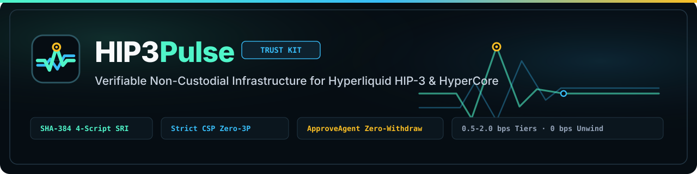

# HIP3Pulse Trust Kit

Client-side cryptographic verification toolkit, security architecture specification, and product overview for **HIP3Pulse** — a non-custodial execution and microstructure risk terminal built exclusively for the **Hyperliquid L1** (HIP-3 + HyperCore) ecosystem.

- **Live Terminal**: [https://hip3pulse.com](https://hip3pulse.com)
- **Telegram Feed**: [@HIP3Pulse](https://t.me/HIP3Pulse)
- **X Updates**: [@HIP3Pulse](https://x.com/HIP3Pulse)

---

## Independent 1-Command Non-Custodial Verification

Requires **Node.js >= 20** with zero third-party packages (`node:crypto` + native `fetch` only):

```bash
node verify_non_custodial.mjs
```

Or specify an explicit origin:

```bash
node verify_non_custodial.mjs https://hip3pulse.com
```

What `verify_non_custodial.mjs` verifies on every run (exits `0` only if all 4 checks pass):
1. **Strict CSP Network Boundary**: Confirms `default-src 'self'`, `script-src 'self'`, `connect-src 'self' https://api.hyperliquid.xyz`, `object-src 'none'`, and `frame-ancestors 'none'` — preventing third-party script injection or off-origin key exfiltration.
2. **4-Script Live SHA-384 SRI Integrity**: Extracts `integrity="sha384-..."` attributes from the served HTML for `/app.mjs`, `/i18n.mjs`, `/vendor/hl-sdk.mjs`, and `/vendor/neural-core.mjs`, downloads the live served byte streams, and asserts 4/4 exact SHA-384 hash parity.
3. **Public Payload Sanitization**: Fetches `/api/enrich?src=api` and verifies zero non-builder `0x` wallet addresses appear anywhere in the public response (all smart-money identities are one-way pseudonymized as `Whale #XXXXXX`).
4. **Hyperliquid L1 Builder Vault Check**: Queries `https://api.hyperliquid.xyz/info` directly to verify the published `builderConfig.address` is in standard mode and meets the protocol equity requirement (`>= 100 USDC`).

---

## Core Capabilities

- **Oracle Regime & Corporate-Action Guardrails**: Distinguishes active external spot sessions from off-hours `30m EMA` oracle decay regimes across 10 global market calendars; screens US `4-Day ET` ex-dividend gaps, `SPLIT_SETTLEMENT_HALT` forced settlement events, high OI cap saturation (`>= 90% / >= 99%`), and cross-DEX isolated margin pools across `178` live HIP-3 and `179` active HyperCore contracts before sizing.
- **Orderbook-Walked All-In Breakeven Accounting**: Walks live dual-leg L2 orderbooks weighted by $w = N_2 / N_1$, separating Growth (`0.90 / 0.30 bps`) vs Standard (`9.00 / 3.00 bps`) protocol fees, open-only 3-tier Builder fees (`STANDARD 1.0/0.8/0.5` · `PRO 0.8/0.6/0.5` · `WHALE 0.5/0.5/0.5 bps` for IOC / Pair / ALO; **all closes & L1 `SL/TP` permanently `0 bps`**), and adverse hourly funding drag into an exact `0.1 bps` breakeven figure. (Honest same-order-type disclosure: Hyperliquid's native interface supports free `Post-Only` orders; HIP3Pulse's `0.5 bps` open-only ALO fee covers pre-trade risk guardrails, terminal-confirmed `Smart Maker Chase`, and single-leg 24/7 L1 `SL/TP` attachment.)
- **Deterministic Execution, Smart Maker Chase & 24/7 On-Chain L1 `SL/TP`**: Supports same-DEX atomic batches, cross-DEX single-instance captured `pairBundle` dual-leg routing, sequential `Leg 1 ALO (0.5 bps) -> Leg 2 IOC` pairs (`25s` resting guard + post-cancel `orderStatus` verification), race-safe `Smart Maker Chase` (`orderStatus` terminal guard + cumulative chase cap), and single-leg 24/7 on-chain `positionTpsl` `SL/TP` triggers (`0 bps` direct L1, offline-safe; auto-disabled in 2-leg hedge modes). All closes and 3-tier `reduceOnly` unwinds route direct to L1 at `0 bps`.
- **De-Noised Active-Tape Positioning & Liquidation Magnets**: Filters directional smart-money position diffs (`NEW_OPEN / ADD / FLIP`), separates protocol-exact isolated liquidation prices (`ISOLATED_EXACT`) from cross-margin estimates (`CROSS_ESTIMATED`) within `<= 4.0%` (`>= $100k`, `24h` active window), enforces a strict 4-way `AND` live-stream gate (`PUBLIC_DELAYED_10M` default vs `<20s` `BUILDER_LIVE` for active routed wallets), and discloses active-tape OI coverage on an honest `2 * OI` bilateral denominator.

---

## Vision & Engineering Principles

Global equities, indices, macro commodities, and crypto derivatives liquidity are converging onto fully on-chain central limit orderbooks. HIP3Pulse focuses exclusively on the decentralized Hyperliquid L1 ecosystem under three non-negotiable engineering principles:

1. **Strict Non-Custody & Zero Proprietary Conflict**: Private keys remain strictly local. `ApproveAgent` enforces protocol-level zero-withdrawal permissions. We never operate proprietary trading desks against users; revenue comes solely from transparent on-chain Builder execution fees.
2. **Empirical Accounting & Zero Metric Cosmetics**: EMA anchor decay, L2 slippage, bilateral `2 * OI` coverage denominators, and sample accumulation status are disclosed verbatim.
3. **Single-Track Long-Term Engineering Craft**: Continuous focus on execution determinism and edge-case protection under volatile markets.

---

## Documentation

- [SECURITY.md](./SECURITY.md) — Non-custodial key boundary, `ApproveAgent`, `ApproveBuilderFee` cap, `0 bps` unwind escape, CSP, and SRI verification model.
- [ROADMAP.md](./ROADMAP.md) — Four-stage product evolution roadmap.
- [LICENSE](./LICENSE) — MIT license covering this verification toolkit and public documentation.

---

*Disclaimer: HIP3Pulse is a non-custodial market analytics and order-routing interface. Nothing in this repository constitutes financial, investment, or legal advice.*
